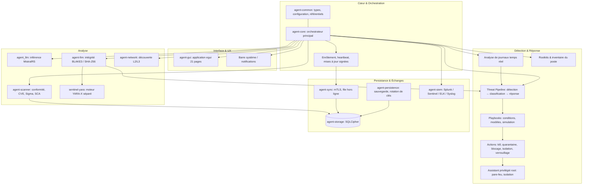

# Sentinel GRC Agent

**L'agent endpoint souverain : conformité, vulnérabilités, détection et réponse**

🏢 **[Cyber Threat Consulting](https://cyber-threat-consulting.com)**
Expert en souveraineté numérique et cyber-défense

<p align="center">
  
</p>


[](https://github.com/CTC-Kernel/sentinel-agent/actions/workflows/ci.yml)
[](LICENSE)


---

Sentinel GRC Agent est un agent d'endpoint écrit en Rust pour Windows, macOS et Linux. Il mesure la conformité du poste aux référentiels (ISO 27001, NIS 2, DORA, CIS…), recherche ses vulnérabilités et les classe selon leur exploitation réelle, détecte les menaces (règles Sigma et YARA, intégrité des fichiers, journaux, rootkits, rançongiciels) et y répond (arrêt de processus, quarantaine, blocage d'adresse, isolation du poste, verrouillage de compte).

Il fonctionne relié à la plateforme GRC (Gouvernance, Risques, Conformité) Sentinel, ou seul, en mode autonome, sans qu'aucune donnée ne quitte le poste. Son assistant IA tourne localement.

> [!IMPORTANT]
> **Développé par [Cyber Threat Consulting](https://cyber-threat-consulting.com)**
> 🌐 Solutions de souveraineté numérique et de cyber-défense
> 📧 [contact@cyber-threat-consulting.com](mailto:contact@cyber-threat-consulting.com)

## 🛡️ Fonctionnalités

### 1. Conformité
- **34 contrôles intégrés** : chiffrement du disque, pare-feu, antivirus, politique de mots de passe, verrouillage de session, mises à jour, SSH, durcissement du noyau, accès distant, journalisation, sauvegardes, stockage USB…
- **Neuf référentiels** : ISO 27001, NIS 2, DORA, CIS v8, SOC 2, PCI DSS, NIST CSF, ANSSI et HDS, avec une note par exigence. Chaque catalogue indique ce que l'agent ne peut pas mesurer depuis le poste (gouvernance, chaîne d'approvisionnement…).
- **Socle de durcissement** : 169 contrôles livrés (90 Linux, 32 macOS, 47 Windows), en français, avec leur correction. Désactivé par défaut (`hardening_benchmark`), car il entre dans le score de conformité.
- **Contrôles de l'organisation**, sans recompiler l'agent : politiques au format SCA en YAML (dossier `sca.d`) et contrôles déclarés en TOML (dossier `checks.d`).
- **Remédiation** des écarts depuis l'interface.
- **Rapports** (synthèse exécutive, audit de conformité, incidents) en HTML ou en PDF ; chaque page du PDF porte l'empreinte SHA-256 de son contenu.

### 2. Vulnérabilités
- **Inventaire** : paquets Debian/Ubuntu et RPM (RHEL, AlmaLinux, Rocky Linux, openSUSE), logiciels installés sous macOS et Windows, paquets Python, Node.js et `cargo install`, extensions de navigateur avec la portée de leurs permissions.
- **Priorité fondée sur l'exploitation réelle** : chaque CVE est croisée avec le catalogue **CISA KEV** (failles déjà exploitées) et le score **EPSS** (probabilité d'exploitation). Les deux sources sont téléchargées en entier puis filtrées sur le poste, qui n'envoie rien.
- **SBOM CycloneDX 1.5** du poste, vulnérabilités et statut d'exploitation compris.

### 3. Détection
- **Règles Sigma** sur les processus et sur les journaux, corrélations comprises (nombre d'événements, valeurs distinctes, séquences ordonnées). 48 règles livrées, en français, avec leurs techniques ATT&CK : force brute SSH, connexion réussie après une force brute, comptes créés ou promus administrateurs, attaques web, journal Windows effacé… Les règles de la communauté SigmaHQ se déposent telles quelles dans `sigma.d`.
- **Analyse des journaux en temps réel** : `log stream` (macOS), `journalctl` (Linux), canaux d'événements Windows, et fichiers déclarés (`log_files` : serveur web, application JSON, syslog, auditd).
- **YARA** sur les fichiers créés ou modifiés, par le moteur YARA-X exécuté dans un programme séparé (`sentinel-yara`, règles dans `yara.d`).
- **Intégrité des fichiers (FIM)** : surveillance temps réel, base conservée et comparée au démarrage (changements faits agent arrêté), analyse complète périodique ; contenu (BLAKE3, SHA-256), permissions et propriétaire, lignes modifiées des petits fichiers texte, auteur du changement quand l'audit du système le dit (`fim_whodata` sous Linux) ; valeurs de démarrage automatique du registre Windows et clés choisies par l'organisation (`registry_keys`).
- **Indicateurs de compromission** : flux texte, CSV, STIX 2.1 et TAXII 2.1 (MISP, OpenCTI…) ; adresses, domaines et empreintes SHA-256 de fichiers malveillants. Aucun flux n'est contacté tant qu'il n'est pas déclaré.
- **Rootkits** (macOS, Linux) : processus, ports d'écoute et modules noyau cachés, bibliothèques imposées à tous les programmes, interfaces en mode promiscuité, programmes supprimés encore en cours d'exécution.
- **Rançongiciels** : fichiers leurres déposés dans les dossiers des utilisateurs ; un leurre chiffré lève aussitôt un incident critique (`ransomware_canaries`, désactivé par défaut).
- **Inventaire du poste** : comptes, groupes, services et ports en écoute, relevés toutes les dix minutes. Un compte ajouté aux administrateurs, un service installé ou un port nouvellement exposé au réseau lève une alerte.
- **Démarrages de processus en temps réel** (`process_event_telemetry`, désactivé par défaut), **réseau** (découverte L2/L3 passive par mDNS, SSDP et ARP, appareils inconnus) et **USB**.

### 4. Réponse
- **Actions** : arrêt de processus (dont l'identité est revérifiée juste avant le signal), quarantaine de fichier, blocage d'adresse IP en entrée et en sortie, isolation réseau du poste (seuls la plateforme, le DNS et le DHCP restent joignables), verrouillage de compte levé à échéance, commandes de réponse déclarées par l'organisation (ouvrir un ticket, prévenir l'astreinte).
- **Playbooks** : conditions sur les alertes et modèles prêts à l'emploi (compte pris par force brute, fichier malveillant, rançongiciel). Une adresse qui récidive est bloquée deux fois plus longtemps à chaque fois, jusqu'à une semaine. Le mode simulation (`playbook_simulation`) consigne ce qui aurait été fait sans rien exécuter.
- **Garde-fous** : l'agent refuse de bloquer le résolveur DNS ou la passerelle, de verrouiller root, un compte système ou le dernier administrateur, de mettre en quarantaine un dossier ou ses propres fichiers. L'isolement se lève depuis un bandeau affiché sur toutes les pages ; il est réappliqué après un redémarrage et levé si sa durée a expiré entre-temps.

### 5. Assistant IA
- **Local** : inférence MistralRS sur le poste (GPU Metal sur Apple Silicon, CPU AVX2 ou générique ailleurs, choisi automatiquement), réponse affichée au fil de la génération, aucune donnée envoyée.
- **Connaît le poste** : résultats des contrôles et leur cause, menaces ouvertes, vulnérabilités exploitées, historique des événements (« que s'est-il passé mardi ? »).
- **Propose des actions** (relancer une analyse, corriger un contrôle, isoler le poste) qui ne s'exécutent qu'après confirmation de l'opérateur.
- **Voix** : dictée Whisper locale, réponses lues, conversation mains libres.
- **Fournisseurs externes au choix** (OpenAI, Anthropic, Google Gemini, API compatible OpenAI) : voir [docs/ai/external-providers.md](docs/ai/external-providers.md). Le modèle local reste le défaut, sans bascule automatique.

### 6. Plateforme, SIEM et cycle de vie
- **Enrôlement** par jeton (JWT portant l'`organizationId` du tenant), heartbeat, commandes de la plateforme, plateforme SaaS ou on-premise.
- **Hors ligne** : ce que la plateforme n'a pas reçu est placé dans une file locale (7 jours) et renvoyé.
- **Actifs & CMDB** : découverte des actifs, cycle de vie (IP, nom, MAC, fabricant, type, criticité) et réconciliation avec les éléments de configuration de la plateforme.
- **SIEM** : Splunk, Microsoft Sentinel, ELK et Syslog (CEF, LEEF, JSON).
- **Mises à jour** vérifiées par un manifeste signé ed25519 qui lie la version au paquet ; le résultat réel est remonté après le redémarrage.
- **Autoprotection** : intégrité du binaire et de la configuration, détection de débogueur, socket des actions privilégiées réservé à l'application Sentinel.

### 7. Interface
- Application de bureau **egui** de 21 pages : tableau de bord, conformité, vulnérabilités, menaces, intégrité des fichiers, réseau et cartographie, comptes & services, logiciels, risques, rapports, assistant IA…
- Design system (typographies Inter et JetBrains Mono embarquées, contraste WCAG vérifié par des tests), thème clair et sombre, navigation repliable.
- Les moteurs de détection et de conformité s'activent depuis les paramètres ; en désactiver un demande le mode administrateur.

---

## 🏗️ Architecture du Système

L'agent est un espace de travail de crates Rust spécialisées, orchestrées par `agent-core`.



---

## 🚀 Mise en Œuvre Rapide

### Prérequis
- **Systèmes** : Windows 10+ (x64), macOS 11+ (Apple Silicon et Intel), Linux x64 et ARM64 (paquets deb et rpm) : Debian 11+, Ubuntu 20.04+, RHEL / AlmaLinux / Rocky 8+, Fedora.
- **Compilation** : Rust édition 2024. Le compilateur est figé dans [`rust-toolchain.toml`](rust-toolchain.toml) et installé automatiquement par rustup.

### Installation

#### Option 1 : paquets pré-compilés
Téléchargez le paquet de votre système depuis la page des
[releases](https://github.com/CTC-Kernel/sentinel-agent/releases/latest), vérifiez-le
avec le fichier `SHA256SUMS-*.txt` publié à côté, puis installez-le. Chaque release
publie aussi le SBOM CycloneDX de l'agent (`sentinel-agent-<version>.cdx.json`).

```bash
# Vérification (exemple Linux x64 ; SHA256SUMS-linux-arm64.txt sur ARM64)
sha256sum --ignore-missing -c SHA256SUMS-linux-amd64.txt

# Debian / Ubuntu (_amd64.deb ou _arm64.deb) : apt installe aussi les dépendances
sudo apt install ./sentinel-agent_*_amd64.deb

# RHEL / AlmaLinux / Rocky / Fedora (.x86_64.rpm ou .aarch64.rpm)
sudo dnf install ./sentinel-agent-*.x86_64.rpm

# macOS (ou double-clic sur le .pkg)
sudo installer -pkg SentinelAgent-<version>.pkg -target /

# Windows
msiexec /i SentinelAgentSetup-<version>.msi
```

#### Option 2 : compilation depuis les sources
```bash
git clone https://github.com/CTC-Kernel/sentinel-agent.git
cd sentinel-agent

# Agent avec l'application de bureau (interface, IA locale, voix)
cargo build --release --package agent-core --features gui

# Agent sans interface, pour un serveur
cargo build --release --package agent-core --no-default-features

# Moteur YARA, programme séparé à placer à côté de sentinel-agent
# (ou désigné par SENTINEL_YARA_HELPER)
cargo build --release --manifest-path tools/sentinel-yara/Cargo.toml
```

### Deux modes, choisis à l'installation

| Mode | Pour qui | Ce qui change |
|------|----------|---------------|
| **Plateforme** | Organisations, MSSP | L'agent s'enrôle avec un jeton et synchronise conformité, inventaire et alertes avec la console Sentinel GRC. |
| **Autonome (standalone)** | Particuliers, postes isolés, protection EDR seule | Gratuit. EDR, intégrité des fichiers, conformité et analyse de vulnérabilités tournent en local ; **aucune donnée ne quitte le poste**, aucun serveur n'est contacté. Connexion à une plateforme possible plus tard depuis les réglages. |

```bash
# Windows (silencieux)
msiexec /i SentinelAgentSetup-<version>.msi /qn INSTALLMODE=STANDALONE     # autonome
msiexec /i SentinelAgentSetup-<version>.msi /qn ENROLLMENTTOKEN=<jeton>    # plateforme

# Debian / Ubuntu
SENTINEL_STANDALONE=1 sudo -E dpkg -i sentinel-agent_*_amd64.deb

# macOS : pkg construit avec SENTINEL_STANDALONE=1, ou choix dans l'assistant au premier lancement

# Basculer après coup
sentinel-agent standalone            # protection locale seule
sentinel-agent standalone --disable  # puis `sentinel-agent enroll` pour rejoindre une plateforme
```

### Configuration Initiale

```bash
# Rejoindre une plateforme : le jeton est demandé à l'invite (ou lu dans
# SENTINEL_ENROLLMENT_TOKEN), ce qui évite de l'exposer dans la ligne de commande.
# Plateforme on-premise : ajouter --server https://<domaine>/fn/agentApi
sudo sentinel-agent enroll

# Édition de la configuration (créée à l'installation du paquet ;
# référence des options : config/README.md)
sudo nano /etc/sentinel/agent.json

# Prise en compte
sudo systemctl restart sentinel-agent
```

| Système | Configuration | Données (base, règles `sigma.d`, `yara.d`, `sca.d`, `checks.d`) |
|---------|---------------|------------------------------------------------------------------|
| Linux | `/etc/sentinel/agent.json` | `/var/lib/sentinel-grc/` |
| macOS | `~/Library/Application Support/SentinelGRC/agent.json` | `~/Library/Application Support/SentinelGRC/` |
| Windows | `C:\ProgramData\Sentinel\agent.json` | `C:\ProgramData\Sentinel\` |

Sous macOS, `~` désigne le compte qui exécute l'agent.

---

## 📦 Crates et composants

| Composant | Rôle | Statut |
|-----------|------|--------|
| [agent-core](crates/agent-core/README.md) | Orchestrateur, service, CLI, EDR, playbooks, analyse de journaux | ✅ Stable |
| [agent-common](crates/agent-common/README.md) | Types, configuration, catalogues des référentiels | ✅ Stable |
| [agent-scanner](crates/agent-scanner/README.md) | Contrôles de conformité, SCA, CVE, moteur Sigma, rootkits | ✅ Stable |
| [agent-fim](crates/agent-fim/README.md) | Intégrité des fichiers BLAKE3 / SHA-256 | ✅ Stable |
| [agent-network](crates/agent-network/README.md) | Découverte L2/L3, détection réseau, cartographie | ✅ Stable |
| [agent-gui](crates/agent-gui/README.md) | Application de bureau egui | ✅ Stable |
| [agent_llm](crates/agent_llm/README.md) | IA locale MistralRS, analyse de sécurité | ✅ Stable |
| [agent-storage](crates/agent-storage/README.md) | Base SQLCipher, dépôts, migrations | ✅ Stable |
| [agent-persistence](crates/agent-persistence/README.md) | Sauvegarde, restauration, rotation de clés | ✅ Stable |
| [agent-sync](crates/agent-sync/README.md) | Synchronisation mTLS, heartbeat, file hors ligne | 🚧 Beta |
| [agent-siem](crates/agent-siem/README.md) | Connecteurs SIEM (CEF, LEEF, JSON) | 🚧 Beta |
| [tools/sentinel-yara](tools/sentinel-yara) | Moteur YARA-X, lancé par l'agent hors de son processus | 🚧 Beta |
| [apps/nexus-web](apps/nexus-web/README.md) | Interface web multi-tenant (démonstration) | 🧪 Prototype |

Documentation supplémentaire :
- [Guide utilisateur](docs/USER_GUIDE.md) : installation, configuration et utilisation quotidienne
- [Configuration](config/README.md) : référence des options et des variables d'environnement, exemples commentés (`agent.full.example.json`, `sigma.example.yml`, `sca.example.yml`, `checks.example.toml`)
- [Signature des mises à jour](docs/UPDATE_SIGNING.md) : clé ed25519 et manifeste signé
- [Fournisseurs IA](docs/ai/external-providers.md) : modèle local ou API externe
- [Journal des modifications](CHANGELOG.md) : ce qui a changé, ce qui a été vérifié et ce qui ne l'a pas été
- [Contribution](CONTRIBUTING.md) : standards de qualité et processus de contribution
- [Sécurité](SECURITY.md) : politique de sécurité et divulgation responsable

---

## 🎯 Cas d'Usage

### Entreprises & MSSP
- **Audit continu** : surveillance permanente de la conformité réglementaire
- **Gestion des vulnérabilités** : correction guidée par l'exploitation réelle (CISA KEV, EPSS)
- **Détection et réponse** : règles Sigma et YARA, playbooks, isolation du poste, preuves d'audit

### Secteurs Régulés
- **Finance** : DORA
- **Santé** : HDS (hébergeur de données de santé)
- **Énergie et opérateurs essentiels** : NIS 2
- **Administration** : référentiels ANSSI, protection des données sensibles et souveraineté

### Particuliers et postes isolés
- **Mode autonome** : protection locale gratuite, sans compte ni serveur

---

## ⚙️ Configuration Avancée

### Fichier de configuration
Extrait de `agent.json` ; la liste complète est dans [config/agent.full.example.json](config/agent.full.example.json).

```json
{
  "standalone": false,
  "server_url": "https://grc.votre-domaine.com/fn/agentApi",
  "check_interval_secs": 3600,
  "active_frameworks": ["ISO27001", "NIS2", "DORA"],

  "log_analysis": true,
  "rootkit_detection": true,
  "system_inventory": true,
  "hardening_benchmark": false,
  "ransomware_canaries": false,
  "playbook_simulation": false,

  "fim_watched_paths": ["/etc", "/usr/local/bin"],
  "fim_ignore_patterns": ["*.log", "*.tmp"],

  "threat_intel_feeds": [
    {
      "name": "feodo-tracker",
      "url": "https://feodotracker.abuse.ch/downloads/ipblocklist.txt",
      "format": "text",
      "refresh_hours": 12
    }
  ]
}
```

### Variables d'Environnement
Les champs de premier niveau se surchargent par `SENTINEL_<NOM_DU_CHAMP>` ([référence](config/README.md)) :

```bash
export SENTINEL_SERVER_URL="https://grc.votre-domaine.com/fn/agentApi"
export SENTINEL_ENROLLMENT_TOKEN="<jeton>"
export SENTINEL_STANDALONE=true
export SENTINEL_LOG_LEVEL=debug
export SENTINEL_DATA_DIR="/srv/sentinel"
export SENTINEL_CA_CERT_PATH="/etc/sentinel/ca.pem"
```

---

## 🔍 Exploitation & Débogage

### Service
```bash
# État du service
sentinel-agent status

# Installation, démarrage et arrêt du service système
sudo sentinel-agent install
sudo sentinel-agent start
sudo sentinel-agent stop

# Désinstallation (--purge supprime aussi configuration, base et journaux ;
# --keep-logs conserve les journaux)
sudo sentinel-agent uninstall --purge

# Toutes les commandes
sentinel-agent --help
```

### Journaux et diagnostic
```bash
# Logs en temps réel (Linux)
sudo journalctl -u sentinel-agent -f

# Lancement au premier plan avec des logs détaillés, sans icône de barre système
sentinel-agent --log-level debug run --no-tray

# Inventaire du poste (comptes, groupes, services, ports en écoute) en JSON
sentinel-agent inventory
```

Sous Windows, les journaux sont dans `C:\ProgramData\Sentinel\logs\`. Ce
dossier de données est réservé à SYSTEM et aux Administrateurs : l'application
de bureau s'ouvre avec les droits d'administrateur.

---

## 🔒 Sécurité par Conception

- **Communication** : mTLS avec TLS 1.3, autorité de certification propre possible (`ca_cert_path`) ; en mode autonome, aucun client réseau vers la plateforme n'est créé.
- **Chiffrement au repos** : SQLCipher (AES-256-CBC, intégrité HMAC-SHA256 par page, clé dérivée par PBKDF2 à 256 000 itérations) pour la base locale.
- **Souveraineté IA** : le modèle de langage s'exécute localement par défaut ; les sources de priorisation (KEV, EPSS) sont téléchargées en entier et filtrées sur le poste.
- **Moindre privilège** : sous Linux, le service tourne sous un compte dédié, confiné par systemd ; seules les actions qui l'exigent (pare-feu, isolation) passent par un assistant root, dont le socket n'accepte que l'application Sentinel.
- **Analyse isolée** : les fichiers suspects sont analysés par YARA dans un processus séparé de l'agent.
- **Intégrité logicielle** : paquet macOS signé et notarisé, MSI signé Authenticode (SignPath, certificat auto-signé à défaut), SBOM CycloneDX et attestation de provenance à chaque release, mises à jour vérifiées par manifeste signé ed25519 une fois la clé configurée ([docs/UPDATE_SIGNING.md](docs/UPDATE_SIGNING.md)).

---

## 🤝 Contribution & Support

### Guide de Contribution

1. **Fork** le repository
2. **Créer** une branche feature (`git checkout -b feature/amazing-feature`)
3. **Commit** vos changements (`git commit -m 'Add amazing feature'`)
4. **Push** vers la branche (`git push origin feature/amazing-feature`)
5. **Ouvrir** une Pull Request

### Standards de Qualité
- **Code Style** : `cargo fmt` et `cargo clippy -D warnings` obligatoires
- **Tests** : la CI refuse toute baisse sous le plancher de couverture (34 % aujourd'hui, relevé à mesure vers 70 %) ; les tests tournent aussi sous macOS et Windows, sans bloquer pour l'instant
- **Documentation** : commentaires `///` pour toutes les APIs publiques
- **Sécurité** : validation `cargo-deny` et recherche de secrets (Gitleaks) avant merge

### Canal de Support

- **🐛 Rapports de Bugs** : [GitHub Issues](https://github.com/CTC-Kernel/sentinel-agent/issues)
- **💡 Suggestions** : [GitHub Discussions](https://github.com/CTC-Kernel/sentinel-agent/discussions)
- **📧 Consulting** : [contact@cyber-threat-consulting.com](mailto:contact@cyber-threat-consulting.com)
- **🏢 Website** : [cyber-threat-consulting.com](https://cyber-threat-consulting.com)

### Licence

Ce projet est sous **Licence MIT** - voir le fichier [LICENSE](LICENSE) pour les détails.

---

## 🙏 Remerciements

- **Rust Community** : écosystème exceptionnel pour la sécurité système
- **MistralRS** : inférence locale performante pour l'IA souveraine
- **egui** : framework GUI immédiat et multi-plateforme
- **SQLCipher** : chiffrement robuste pour la persistance des données
- **SigmaHQ** et **YARA-X** : formats de règles ouverts partagés par la communauté
- **whisper.cpp** : reconnaissance vocale locale

---

<p align="center">
  <strong>🛡️ Sentinel GRC Agent - La Sécurité Souveraine pour l'Ère Numérique</strong>
  <br>
  <em>Built with ❤️ and Rust by <a href="https://cyber-threat-consulting.com">Cyber Threat Consulting</a></em>
  <br>
  <a href="https://cyber-threat-consulting.com">🌐 Visitez notre site</a>
</p>
